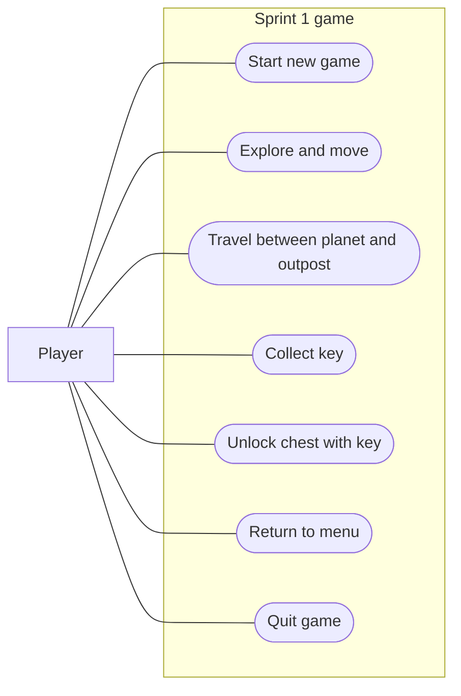

# Sprint 1 — A Link Between Galaxies

## Evidence and scope

Confirmed in the local repository: Godot 4.6/GDScript; a menu with Play and Quit; an inactive Load button; animated astronaut movement using arrow keys; a tile-built test world with collision shapes; E interactions that collect keys and spend them to remove locked chest tiles; sounds for success/failure. The working tree was clean before this work. Existing implementation came from the repository; this report does not attribute it to individual teammates.

The README proposes movement, wall collisions, a key, and a locked door. It explicitly calls these proposals pending TA refinement. The implemented keyed objects are chests, not a completed door progression mechanic. Its broader combat, inventory, puzzles, ship upgrades, and planet progression are future plans.

The user's Sprint 1 request calls for a working MVP covering a basic landing UI and movement between areas, plus documentation and team-managed checklist items. Their reports of Logan's and Farhan's suggestions are context, not independently verified instructor feedback. No separate storyboards, assignment documents, issue exports, task lists, or previous use case diagram were present locally. Remote issues/Wiki were not accessed or changed.

Assumptions: a tiny planet/outpost exploration loop is sufficient for a demo; the landing pad and simple outpost are placeholders until storyboards are supplied; no Options is preferable to a button with no setting. These are implementation choices, not team or GTA-approved decisions.

## Actual MVP

- New Game and Quit menu with the correct game title and keyboard focus.
- Existing astronaut, arrow-key movement, tile world, assets, and interaction sounds.
- Existing tile collisions plus explicit outer boundaries for both areas.
- Landing pads: E near the planet portal visits the outpost; E near the outpost portal returns.
- Visible controls, location, portal prompt, and current key count.
- Existing key pickups and locked chests. Exploration state persists while traveling between areas in one session.
- Escape or the menu button; New Game starts a fresh world with keys/chests restored.
- No save/load, Options, combat, accounts, networking, ship upgrades, or full inventory.

The two areas share a scene and use teleportation between distant map locations. Keeping both loaded is a small implementation that preserves the current session's changed tiles without introducing a save system.

## Implementation summary

| Source | Responsibility |
| --- | --- |
| `project.godot` | Existing input actions/renderer retained; main scene uses an explicit resource path for first import. |
| `scenes/home_menu.tscn` | Correct title, New Game, Quit; remove inactive Load. |
| `scripts/main_menu.gd` | Focus New Game; existing scene start and quit callbacks. |
| `scenes/testworld.tscn` | Existing authored tile data and player preserved; attach demo controller. |
| `scripts/demo_world.gd` | Small outpost using existing tiles, labeled portals, travel, boundary guards, HUD, menu return. |
| `scripts/player.gd` | Preserve movement/key/chest systems; animate vertical movement and convert interaction position into decoration-local coordinates. |
| `scenes/player.tscn`, `assets/` | Reused unchanged. |
| `tests/sprint1_smoke.gd` | Godot integration smoke check using input actions, scene changes, actual tiles, and reset assertions. |

## Challenges encountered

1. The existing map has a south wall below the starting room. A first portal placement south of spawn failed the walking test. Moving the portal north into the same walkable room made it reachable without altering teammates' tile map.
2. Travel must preserve removed tiles and key count, while New Game must restore them. Keeping both areas loaded preserves exploration state; returning to the menu and loading a new scene resets it.
3. The player's animation only ran for horizontal movement. Applying the existing moving animation for either movement axis fixes the vertical case without adding assets.
4. Interaction originally supplied a global position directly to a tile map coordinate method. Explicit conversion to decoration-local space avoids incorrect targeting when that layer is transformed.
5. Godot was absent from this environment. An official 4.6 runtime was downloaded to the chat's scratch folder for validation, without adding a dependency or binary to the team repository. Sandbox restrictions prevented normal user-data log creation; an explicit scratch log path allowed headless runtime checks. A graphical launch failed, so visual/audio QA remains for the team.

## Demo walkthrough

1. Open `project.godot` with Godot 4.6, finish import, press **F5**.
2. Select **New Game**. Point out the controls and key count.
3. Use the arrow keys to move; walk north about 20–30 world pixels from spawn toward the landing pad.
4. Press **E** near the diamond. The location changes to Outpost.
5. Walk around the small room and toward its edges to show boundaries. Walk south toward the landing pad and press **E** to return.
6. Optionally explore the existing planet keys/chests: face a neighboring key tile and press E; face a locked chest and press E to spend a key. This is existing interaction behavior, not a new inventory system.
7. Press **Esc**, or click **Menu · Esc**. Select **New Game** again to show a fresh session.

## Verification

Godot 4.6 asset import completed. Automated headless checks exercise menu loading and its New Game signal, arrow movement from spawn to the portal, E travel to the outpost and back, outpost boundary containment, planet outer bounds, existing decoration collision, key pickup, keyed chest removal, Escape to menu, fresh-session key/tile reset, and the menu button's callback. The test exits nonzero for failed assertions.

After importing assets, run from the repository:

```sh
godot --headless --path . --script res://tests/sprint1_smoke.gd
```

Validation limitations: headless assertions do not establish visual quality, audible playback, mouse hit targets, human keyboard feel, or storyboard fidelity. Escape is injected as a keyboard event; movement/interact use Godot input actions. The menu signal/callback is exercised programmatically. A teammate must perform the walkthrough in a graphical Godot session. This is an exploration MVP with no win condition. Map interiors remain as authored; only outer bounds are added.

## Proposed revised use case diagram

No prior diagram was available, so this is a proposed Sprint 1 replacement, not a verified revision of a supplied diagram. Mermaid renders this as an approximation of actor/use-case notation.



Proposed changes relative to the README's initial stories: add menu/session navigation and two-area travel; retain exploration and key collection; describe the actual keyed chest instead of claiming a working locked door. Boundaries are an exploration constraint, not a separate player goal. Omit combat, saves, ship upgrades, and other future use cases. The team should compare this with the official diagram before adopting it.

## Proposed next-sprint backlog

Unassigned proposals; no invented issue numbers or commitments:

- Reconcile actual Sprint 1 acceptance criteria and area layout with GTA feedback and storyboards.
- Add one small key-gated door or exit with a visible objective and completion cue, if approved.
- Improve interaction targeting/prompts and distinguish key/chest artwork for a first-time player.
- Refine camera framing, room boundaries, and UI after hands-on playtesting on team machines.
- Only then select one small puzzle or basic enemy for the next vertical slice; defer large progression systems.

## Team still needs to supply or update

- Official assignment checklist, stories/tasks, storyboards, and original use case diagram; confirm the MVP against them.
- Actual GTA/professor feedback and any resulting requirement changes. None has been invented here.
- Sprint leadership, issue ownership, contributions, estimates, timeline, and status updates using real team decisions.
- Link this work to actual issues, review changes, and perform a graphical demo on a team machine.
- Confirm asset provenance/license obligations for the assets already in the repository.
- Commit/push reviewed source and publish the Wiki draft through the team's normal workflow. At initial handoff, changes were local. The user subsequently authorized committing and pushing the implementation; remote issue changes and Wiki publishing remain outside this work.

## Editor compatibility follow-up

The bundled `addons/github-integration` plugin contains Godot 3 editor scripts and visual-shader resources. Its `graph_offset` deprecation and invalid shader output-port errors originate in those legacy resources. A `.gdignore` excludes that unused editor-only folder from Godot 4 scanning while preserving its files. The game does not reference the plugin. Restart the editor after this change; use the team’s usual Git client for repository operations.

## Visual polish follow-up

Replaced the temporary diamond markers with the existing purple platform artwork, presented as transfer landing pads. The planet pad remains north of spawn on the original walkable floor. The outpost now has metal floor panels, collidable storage lockers/supply props placed away from the central walking route, and small area labels. A nearby prompt reads “Press E to enter outpost” or “Press E to return to planet” and hides when out of reach. A compact top-left location/key/menu bar and bottom-left movement/interaction hint replace the large instruction stack. Both directions of travel, original key/chest behavior, boundaries, and session reset remain unchanged. These decorations add no new inventory, mission, or supply interactions.
